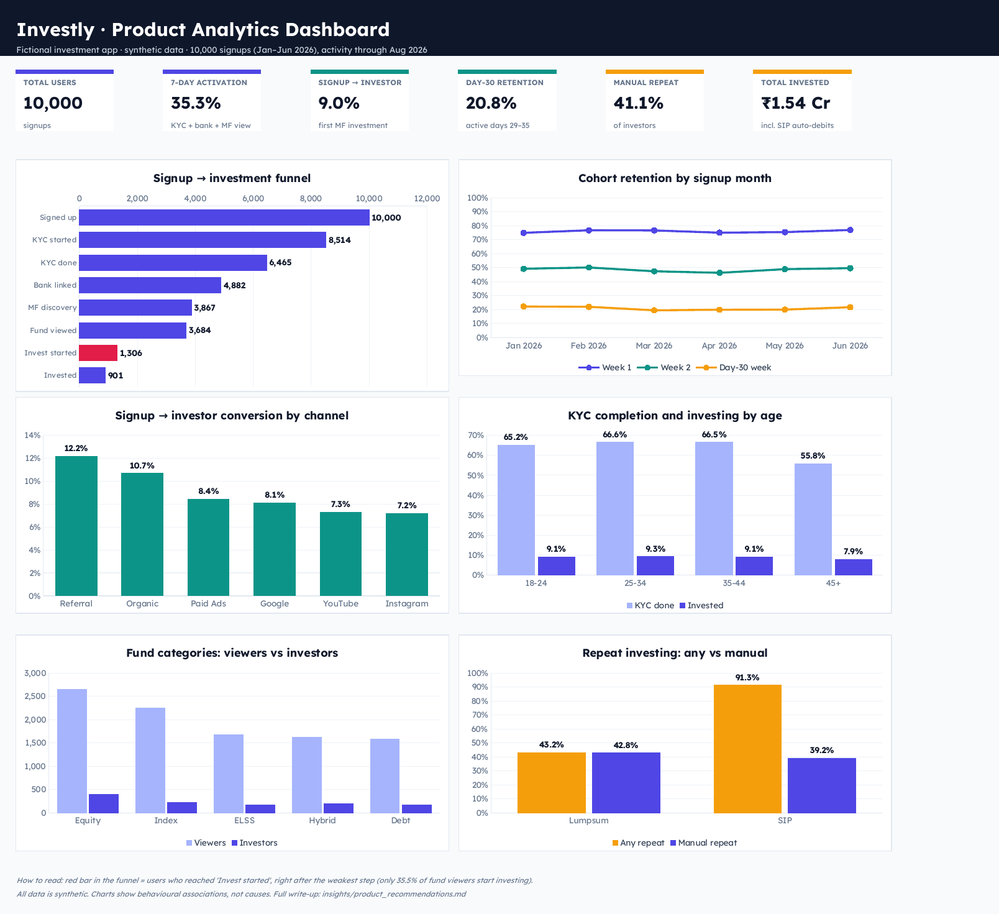

# Investly — Investment App Product Analytics

**SQL (PostgreSQL) · Product Analytics · Funnel, Cohort & Segment Analysis · PRD · Experiment Design**

A product analytics case study on a **fictional** Indian investment app, Investly. It investigates where users drop off between signup and their first mutual fund investment, which users behave differently, and what the product team should test next.

> **All data is synthetic.** It was generated by `generate_data.py` with documented rules (`data/DATA_GENERATION.md`). The project demonstrates an analysis method, not real-market findings, and every behavioural comparison is correlational.



---

## Business question

> Where do users drop off in the investment journey, which user segments behave differently, and what product changes could improve activation and investment conversion?

## Dataset

| Table | Rows | Description |
|---|---|---|
| `users` | 10,000 | Signups Jan–Jun 2026: age group, city tier, acquisition channel, platform, risk profile |
| `events` | 125,149 | In-app events: onboarding, fund discovery, investing, portfolio views |
| `investments` | 2,729 | Transactions, including monthly SIP auto-debits |
| `campaigns` | 30 | Monthly marketing spend per channel |

Dirty data was injected on purpose (duplicates, orphan events, bad timestamps, invalid amounts) so the data-quality step has real problems to catch.

## User journey analysed

```
Signup → KYC started → KYC completed → Bank linked → MF discovery
       → Fund viewed → Investment started → Investment completed → Repeat
```

---

## Key findings

| # | Finding | File |
|---|---|---|
| 1 | Only **9.0%** of signups made a mutual fund investment; **35.3%** activated within 7 days | 02, 08 |
| 2 | The weakest step in the whole journey is **fund viewed → investment started (35.5%)**. 2,378 users looked at a fund and left | 03 |
| 3 | **31%** of users who started an investment didn't complete it: the highest-intent drop-off | 03 |
| 4 | **Referral** has the best conversion (12.2%) and lowest cost per investor (**₹849**). **YouTube** costs 3.6× more (**₹3,031**). Instagram converts worst (7.2%) but is still 2nd cheapest per investor | 04 |
| 5 | **Tier 3 cities** and **45+ users** lag, and in both the gap starts at **KYC**, not at the investment decision | 04 |
| 6 | Only **~21%** of users are active a month after signup; the steepest loss is **week 1 → week 2** | 05 |
| 7 | Among fund viewers, **SIP-calculator users invested at 2.3× the rate** of non-users. This is an association, not proof of cause | 06 |
| 8 | SIP starters show a **91% repeat rate**, but only **39%** invest again manually. Almost all SIP "repeat" activity is auto-debits | 07 |
| 9 | **Index funds** are the 2nd most viewed category but convert worst (**9.7%** vs Equity 14.8%) | 07 |

## Product recommendations (summary)

1. **Week-1 activation nudges** for users stuck mid-onboarding (widest reach, cheapest to test)
2. **Checkout recovery:** log payment failure reasons, add retry and reminders
3. **SIP projection on the fund page:** designed as an **A/B test** because the calculator evidence is correlational
4. **Assisted / vernacular KYC** research for Tier 3 and 45+ users
5. **Index fund research** before building anything
6. **Track cost per investor**, not cost per signup, and shift spend toward referral
7. **Measure SIP health with persistence**, not repeat rate

Full write-up with hypotheses, success metrics, guardrails, RICE prioritisation and the experiment design (incl. sample size): [`insights/product_recommendations.md`](insights/product_recommendations.md)

PRD for the SIP projection feature: [`insights/prd_sip_projection.md`](insights/prd_sip_projection.md)

---

## Project structure

```
investment-app-product-analytics/
├── README.md
├── generate_data.py                 # builds the synthetic dataset (seed 42)
├── data/
│   ├── users.csv  events.csv  investments.csv  campaigns.csv
│   └── DATA_GENERATION.md           # every rule built into the data
├── sql/
│   ├── 00_setup.sql                 # create tables, load CSVs
│   ├── 01_data_quality.sql          # 8 data-quality checks
│   ├── 01b_clean_data.sql           # clean analysis tables
│   ├── 02_user_activation.sql       # onboarding funnel, 7-day activation
│   ├── 03_investment_funnel.sql     # mutual fund funnel
│   ├── 04_user_segmentation.sql     # channels, cost per investor, segments
│   ├── 05_retention_cohort.sql      # monthly cohort retention
│   ├── 06_product_usage.sql         # calculator / search / watchlist vs investing
│   ├── 07_investment_analysis.sql   # repeat investing, time between investments, fund categories
│   └── 08_final_insights.sql        # headline KPIs
├── dashboard/
│   ├── investly_dashboard.xlsx
│   └── screenshots/dashboard.png
└── insights/
    ├── product_recommendations.md
    └── prd_sip_projection.md
```

## SQL techniques used

`JOIN` / `LEFT JOIN` (incl. referential-integrity checks) · `GROUP BY` / `HAVING` · `CASE WHEN` · `COUNT(DISTINCT)` · `COALESCE` · CTEs (incl. chained CTEs) · `DATE_TRUNC` · `INTERVAL` · `UNION ALL` · subqueries · window functions `ROW_NUMBER()` and `LAG()` · `PERCENTILE_CONT` (median)

## Data quality

Before any analysis, 8 checks were run. Issues found and handled: 600 duplicate events, 25 events from non-existent users, 30 events logged before signup, 6 zero/negative investments, 4 duplicate transactions, and 8 users with missing age. Raw tables were kept untouched and analysis ran on cleaned copies.

## Analysis decisions worth noting
- **Counting users, not events.** `COUNT(*)` would inflate every funnel stage; `COUNT(DISTINCT user_id)` is used throughout.
- **Optional features are not funnel steps.** Search and the calculator are analysed separately, not as funnel drop-offs.
- **Fair comparisons.** Feature usage is compared only among users who viewed a fund, to avoid comparing users at different funnel stages.
- **Retention windows of equal length.** A first attempt used 1-, 7- and 30-day windows and showed retention *rising* over time, which is impossible. It was fixed with equal 7-day windows (documented in `05`).
- **Auto-debits separated from user behaviour** in repeat-investment metrics.

## How to run

1. Install PostgreSQL (e.g. Postgres.app on Mac).
2. Optional, to regenerate the data: `pip install numpy pandas`, then `python generate_data.py`.
3. From the project folder:
   ```
   createdb investly
   psql -d investly -f sql/00_setup.sql
   psql -d investly
   ```
4. Inside psql, run the files in order, e.g. `\i sql/01_data_quality.sql`.

## Limitations
- Synthetic data: patterns reflect the generator's documented rules.
- All behavioural comparisons are correlational; causal claims need controlled experiments.
- No A/B test was run. The experiment in `insights/` is a design, and no results are claimed.
- Channel analysis counts investors, not investment value or lifetime value.
- Week-1 retention includes onboarding events, which inflates it relative to later weeks.
